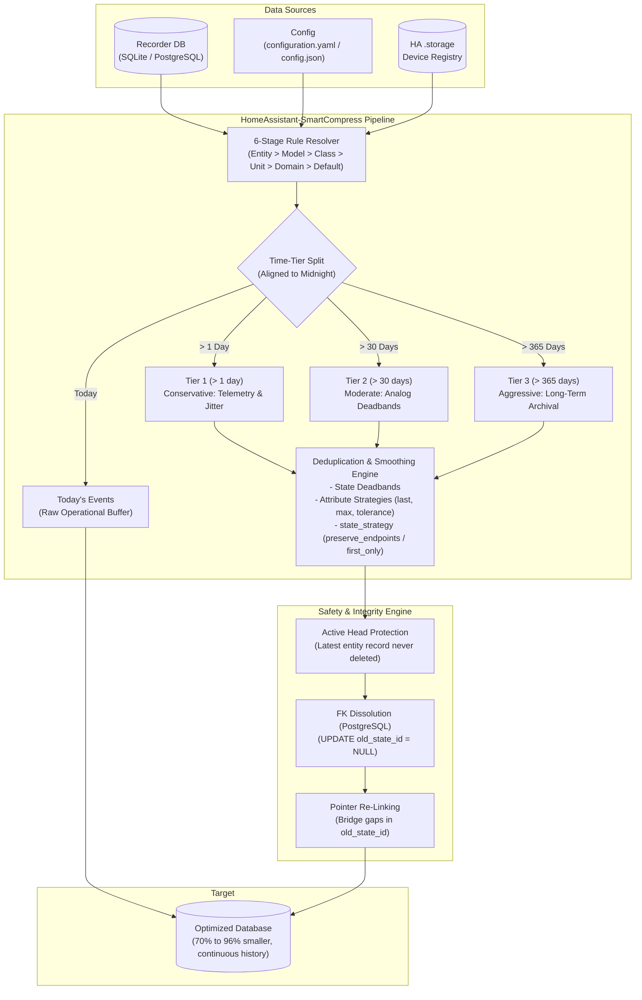
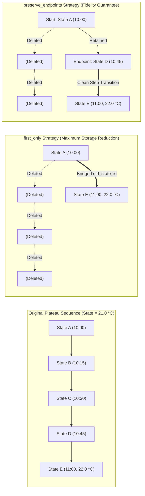

# HomeAssistant-SmartCompress

[](https://www.python.org/downloads/)
[](https://www.home-assistant.io/)
[](#database-support)
[](LICENSE)
[](#database-integrity--safety)

**Intelligent, time-tiered database compression, attribute smoothing, and deduplication tool for Home Assistant.**

---

## The Problem

Home Assistant's recorder database frequently balloons to tens of gigabytes. Even with a conservative purge retention (e.g. 10–30 days), Zigbee/Z-Wave devices, battery monitors, thermostats, smart plugs, and telemetry sensors generate millions of redundant state changes:

- **Periodic telemetry pings:** `uptime`, `linkquality`, `rssi`, `last_seen`, and timestamp ticks write full database rows every few seconds even when the primary state has not changed.
- **Micro-jitter and ADC noise:** Temperature jumping between `21.04 °C` and `21.05 °C`, voltage fluctuations of `0.02 V`, or power fluctuations of `0.1 W`.
- **Aggressive schedules:** Devices like TRV radiator valves (e.g. Sonoff TRVZB) broadcasting redundant weekly schedules and room temperatures every 10–30 seconds.

Standard Home Assistant purges force an all-or-nothing trade-off: either delete entire history blocks or let your database bloat, slowing down dashboard card loading, backups, and Grafana queries.

**HomeAssistant-SmartCompress solves this by intelligently compressing history across customizable time tiers without losing true state changes or graph fidelity.**



---

## Key Features

- **Age-Aligned Time Tiers:** Compress older historical records progressively:
  - *Today (since midnight):* Kept completely uncompressed as a raw operational buffer.
  - *> 1 day (Conservative / Level 1):* Strips volatile telemetry noise (`last_seen`, `uptime`, `linkquality`, `battery` jitter).
  - *> 30 days (Moderate / Level 2):* Applies analog sensor deadbands (`temperature`, `voltage`, `power`, `humidity`).
  - *> 365 days (Aggressive / Level 3):* Wider deadbands and aggressive telemetry compression for long-term archival.
- **Graph & Waveform Integrity (`preserve_endpoints`):**
  - Unlike naive deduplicators that delete all duplicates and distort rectangular step-functions in Grafana/ApexCharts, `preserve_endpoints` keeps both the first state and the last state before any transition.
  - Intermediate duplicate rows are removed, but the plateau and step edges remain 100% faithful.


- **Intelligent Attribute Smoothing:**
  - `"last"`: Updates the retained state with the final attribute state (e.g., `last_seen`).
  - `"max"`: Retains the peak value over a plateau (e.g., `uptime`).
  - `"tolerance"`: Filters noise within numeric bands (e.g. `±0.1 °C`, `±1.0 V`, `±1.0 %`).
- **6-Stage Cascading Rule Hierarchy:**
  Matches rules using an unambiguous priority score:
  1. Exact Entity (`climate.bedroom`) & Wildcard (`*_schedule_*`, `*_battery`) — *Score 10 / 8*
  2. Hardware Model (auto-resolved from HA `.storage` device registry, e.g. `TRVZB`) — *Score 5*
  3. Device Class (`battery`, `humidity`, `temperature`) — *Score 2*
  4. Unit of Measurement (`°C`, `V`, `W`, `hPa`, `KiB/s`) — *Score 1*
  5. Domain (`sensor`, `climate`, `switch`) — *Score 1*
  6. Default Fallback Rules
- **Database Safety & Integrity Guarantee:**
  - **Foreign Key Bridging:** Updates `old_state_id` across deleted gaps so state chains remain continuous.
  - **Active Head Protection:** The newest record of an entity is **never deleted**, ensuring Home Assistant's live state machine and subsequent inserts encounter no foreign key or state errors.
  - **PostgreSQL Reference Dissolution:** Automatically sets `old_state_id = NULL` on targets prior to chunked deletion, preventing PostgreSQL `ForeignKeyViolation` errors without requiring database superuser permissions.
- **Read-Only Simulation & Analysis Modes:**
  - `--simulate` (`-s`): Tests all compression levels against your database, computes actual row savings, and measures real CPU throughput and runtime estimates.
  - `--details` (`-d`): Generates a per-entity breakdown table.
  - `--analyze` (`-a`): Automatically scans high-volume entities, calculates attribute variance, delta spans, and suggests optimal tolerance rules.

## Proven Benchmarks

Tested on a production Home Assistant database:
- **Raw Uncompressed Database:** **6.4 GB** (`home-assistant_v2.db`), **2,114,107 states** across 865 entities.
- **Attributes Table:** ~1.7 Million shared attribute records.

### Complete Compression Results (From Raw 2.11M State Baseline)

| Setting / Run | Deleted Rows | Remaining Rows | Cumulative Savings | Description |
| :--- | :---: | :---: | :---: | :--- |
| **Raw Database** | — | 2,114,107 | **0.0%** | Full uncompressed database (6.4 GB on disk) |
| **Baseline (Exact Match)** | 16,556 | 2,097,551 | **0.78%** | Identical states & exact byte-identical attributes |
| **Level 1 (Conservative)** | 841,612 | 1,272,495 | **39.81%** | Telemetry noise, uptime/last_seen & battery jitter |
| **Level 2 (Moderate)** | 1,482,995 | 631,112 | **70.15%** | Inherits L1 + analog deadbands (temp, power, volt) + TRV schedule noise |
| **Level 3 (Aggressive / Archival)** | 2,046,607 | ~67,500 | **96.81%** | Inherits L2 + wider sensor deadbands & network attributes |

### Maintenance Pass Performance (On Compressed History)
On subsequent daily maintenance runs, the tool verifies up to **300,000 states/second** on standard hardware, taking just seconds to optimize newly accumulated telemetry.

---

## Installation

### Prerequisites
- Python 3.9 or higher
- Access to your Home Assistant SQLite (`home-assistant_v2.db`) or PostgreSQL database.

### Setup
```bash
git clone https://github.com/bmaehr/HomeAssistant-SmartCompress.git
cd HomeAssistant-SmartCompress

# Optional: Install requirements for PostgreSQL or YAML support
pip install -r requirements.txt
```

*(For pure SQLite usage with JSON config, Python standard library is sufficient — zero third-party dependencies required.)*

---

## Quick Start

### 1. Configure Connection
Create a `config.json` or copy one of the example files:

```bash
# For PostgreSQL:
cp config.postgres.example.json config.json

# For SQLite:
cp config.sqlite.example.json config.json
```

Or simply point directly to your Home Assistant `configuration.yaml` (the script automatically extracts `recorder.db_url` and resolves `secrets.yaml`):

```json
{
  "configuration_yaml": "/etc/homeassistant/configuration.yaml",
  "compression_tiers": [
    { "older_than_days": 365, "level": "aggressive" },
    { "older_than_days": 30, "level": "moderate" },
    { "older_than_days": 1, "level": "conservative" }
  ],
  "rules_file": "compression_rules.json",
  "chunk_size": 2000
}
```

### 2. Simulate & Review (Safe & Read-Only)
Always run a simulation first to verify potential savings without modifying your database:

```bash
python3 homeassistant-smartcompress.py --simulate
```

To see which specific entities consume the most rows and how each level compresses them:

```bash
python3 homeassistant-smartcompress.py --simulate --details
```

To target a single entity or wildcard pattern:

```bash
python3 homeassistant-smartcompress.py --simulate --details --entity "sensor.temperature_*"
```

### 3. Analyze Attribute Jitter (Read-Only)
Discover which attributes trigger the most database writes:

```bash
python3 homeassistant-smartcompress.py --analyze --top-entities 10
```

### 4. Execute Compression
Once satisfied with the simulation, run the live compression:

```bash
python3 homeassistant-smartcompress.py
```

---

## CLI Options

```text
usage: homeassistant-smartcompress.py [-h] [--level LEVEL] [--entity ENTITY]
                                      [--simulate] [--details]
                                      [--limit-entities LIMIT_ENTITIES]
                                      [--analyze]
                                      [--top-entities TOP_ENTITIES]
                                      [--top-attributes TOP_ATTRIBUTES]
                                      [config_file]

positional arguments:
  config_file           Path to config file or configuration.yaml (optional)

options:
  -h, --help            Show this help message and exit
  --simulate, -s        Simulate and compare all compression settings (read-only)
  --details, -d         Show detailed entity-level breakdown in simulation report
  --analyze, -a         Run in attribute variance analysis mode (read-only)
  --level LEVEL, -l     Force a static compression level (1, 2, 3 or conservative, moderate, aggressive)
  --entity ENTITY, -e   Target a specific entity ID or wildcard (e.g. 'sensor.power_*')
  --limit-entities N    Limit simulation or execution to top N entities by row count
  --top-entities N      Number of top entities to analyze in --analyze mode
  --top-attributes N    Number of top changing attributes to report in --analyze mode
```

---

## Rule Configuration (`compression_rules.json`)

Rules are organized in cascading inheritance levels:

```json
{
  "levels": {
    "1": {
      "name": "conservative",
      "state_strategy": "preserve_endpoints",
      "default_attribute_rules": {
        "last_seen": { "strategy": "last" },
        "uptime": { "strategy": "max" },
        "linkquality": { "strategy": "ignore" }
      }
    },
    "2": {
      "name": "moderate",
      "inherits": 1,
      "state_strategy": "first_only",
      "unit_attribute_rules": [
        {
          "selectors": { "unit": "°C" },
          "state_tolerance": 0.1,
          "attribute_rules": {
            "temperature": { "strategy": "tolerance", "tolerance": 0.1 }
          }
        }
      ],
      "device_attribute_rules": [
        {
          "selectors": { "model": "TRVZB" },
          "attribute_rules": {
            "schedule": { "strategy": "ignore" },
            "local_temperature": { "strategy": "tolerance", "tolerance": 0.2 }
          }
        }
      ]
    },
    "3": {
      "name": "aggressive",
      "inherits": 2,
      "state_strategy": "first_only"
    }
  }
}
```

---

## Automation (Systemd / Cron)

To keep your Home Assistant database permanently compact and fast, schedule HomeAssistant-SmartCompress to run nightly.

### Crontab Example
```cron
# Run daily at 03:30 AM
30 3 * * * /usr/bin/python3 /opt/homeassistant-smartcompress/homeassistant-smartcompress.py /etc/homeassistant/configuration.yaml >> /var/log/ha-smartcompress.log 2>&1
```

### Systemd Timer Example

`/etc/systemd/system/ha-smartcompress.service`:
```ini
[Unit]
Description=HomeAssistant-SmartCompress Database Optimization
After=network.target

[Service]
Type=oneshot
User=root
WorkingDirectory=/opt/homeassistant-smartcompress
ExecStart=/usr/bin/python3 /opt/homeassistant-smartcompress/homeassistant-smartcompress.py config.json
```

`/etc/systemd/system/ha-smartcompress.timer`:
```ini
[Unit]
Description=Run HomeAssistant-SmartCompress daily at 03:00

[Timer]
OnCalendar=*-*-* 03:00:00
Persistent=true

[Install]
WantedBy=timers.target
```

Enable and start:
```bash
systemctl daemon-reload
systemctl enable --now ha-smartcompress.timer
```

---

## Contributing

Contributions, feature requests, and rule improvements are very welcome!
- If you have specific device models (Sonoff, Shelly, Zigbee2MQTT, ESPHome) generating noisy telemetry, feel free to submit PRs adding selectors to `compression_rules.json`.
- Please ensure tests and simulations pass before submitting pull requests.

---

## License

This project is licensed under the [MIT License](LICENSE).
