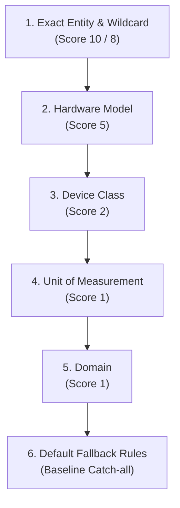

# Specification: HomeAssistant-SmartCompress

## 1. Overview
HomeAssistant-SmartCompress is an intelligent database compression, attribute smoothing, and deduplication tool designed for the Home Assistant (HA) recorder backend (PostgreSQL and SQLite). It purges redundant state transitions (events) from the `states` table across customizable time tiers, keeping the primary state changes and semantically meaningful attribute histories fully intact.

## 2. Core Features
*   **State Deduplication & Smoothing:** Prunes sequential records for an entity (`metadata_id`) whenever the primary state value (`state`) remains identical within defined numeric or discrete deadbands.
*   **Intelligent Attribute Filtering:** Ignores or smooths specific JSON attributes (e.g. `uptime`, `linkquality`, `last_seen`, `battery`) during state comparison.
*   **Database Integrity & Active Head Protection:**
    *   Re-links the `old_state_id` chain of surviving records to eliminate broken pointer references across deleted gaps.
    *   Dissolves incoming foreign keys on PostgreSQL before deletion (`old_state_id = NULL`) to completely prevent `ForeignKeyViolation` errors without requiring superuser permissions.
    *   Protects the most recent record of each entity (`active head`) from being deleted, ensuring Home Assistant's runtime state machine and subsequent state inserts continue without disruption.
*   **Multi-Database Support:** Native compatibility with PostgreSQL and SQLite, featuring auto-detection via `configuration.yaml` (including `secrets.yaml` resolution) or dedicated JSON configuration files.
*   **Caching & Batch Processing:** Employs `lru_cache` for attribute lookups (`state_attributes`) and memory-efficient chunking for DELETE and UPDATE operations.
*   **Read-Only Simulation & Analysis Modes:**
    *   `--simulate` / `-s`: Simulates and benchmarks reduction potential across all compression levels and time tiers simultaneously, reporting throughput and projected runtimes.
    *   `--analyze` / `-a`: Profiles attribute variance and telemetry jitter across top high-volume entities to help discover optimal deadbands and rule parameters.

## 3. Technical Requirements
*   **Language:** Python 3.9+
*   **Dependencies:**
    *   `sqlite3` (Python standard library)
    *   `psycopg2-binary` (required only for PostgreSQL connections)
    *   `PyYAML` (required only when reading `configuration.yaml`)

## 4. Configuration
Configuration is divided into two separate files:

### 4.1 Base Configuration (`config.postgres.json` / `config.sqlite.json` / `config.json`)
*   **`config.postgres.json`:**
    *   `db_adapter`: `"postgres"`.
    *   `postgres`: Connection parameters (`url` with JDBC URI support, `user`, `password`, `dsn`).
*   **`config.sqlite.json`:**
    *   `db_adapter`: `"sqlite"`.
    *   `sqlite`: Database file path (`path`).
*   **Shared Parameters:**
    *   `compression_tiers`: Time-based cascades evaluated relative to midnight (e.g., today 00:00):
        *   `older_than_days`: Threshold age in full days (e.g. `365`, `30`, `1`).
        *   `level`: Associated compression level (`"aggressive"`, `"moderate"`, `"conservative"` or `3`, `2`, `1`).
        *   Events from the current day (since today's midnight) remain uncompressed by default as a raw operational buffer.
    *   `compression_level`: Fallback compression level when time tiers are not configured.
    *   `rules_file`: Path to the compression rules definition (default: `"compression_rules.json"`).
    *   `analysis`: Parameters for analysis mode (`enabled`, `top_entities`, `top_attributes`).
    *   `chunk_size`: Batch size for DELETE statements (default: `2000`).

By default, the script loads `config.postgres.json` (or `config.sqlite.json` / `config.json`). A custom configuration file can be supplied via the command line (e.g. `python3 homeassistant-smartcompress.py config.sqlite.json`).

Alternatively, point directly to Home Assistant's `configuration.yaml` (e.g. `python3 homeassistant-smartcompress.py /etc/homeassistant/configuration.yaml` or via `"configuration_yaml"` in JSON). The script automatically reads `recorder.db_url` (resolving `!secret` via `secrets.yaml`) and defaults to the standard local `home-assistant_v2.db` if SQLite is active.

### 4.2 Rules Configuration (`compression_rules.json`)
Defines hierarchical filtering rules evaluated in a strictly scored precedence order, supporting level inheritance:

*   **Selector Precedence Hierarchy (from most specific to least):**
    1.  **Exact Entity & Wildcard (`device_attribute_rules`):**
        *   `selectors: { "entity": "climate.living_room_trv" }` (Score 10) or wildcards `selectors: { "entity": "*_last_seen" }` / `selectors: { "entity": "*_schedule_*" }` (Score 8): Highest priority for targeted entities or `fnmatch` patterns.
    2.  **Hardware Model (`device_attribute_rules`):**
        *   `selectors: { "model": "TRVZB" }` / `{ "model": "368308_2010" }` (Score 5): Automatically matched across devices using `core.device_registry` and `core.entity_registry`.
    3.  **Device Class (`device_attribute_rules`):**
        *   `selectors: { "device_class": "battery" }` / `{ "device_class": "humidity" }` / `{ "device_class": "atmospheric_pressure" }` (Score 2): Semantically overrides general unit rules.
    4.  **Unit of Measurement (`unit_attribute_rules`):**
        *   `selectors: { "unit": "°C" }`, `{ "unit": "%" }`, `{ "unit": "hPa" }`, `{ "unit": "m3" }`: Matches based on the unit registered in `statistics_meta` or state attributes.
    5.  **Domain (`device_attribute_rules`):**
        *   `selectors: { "domain": "sensor" }` / `{ "domain": "climate" }` (Score 1): General fallback for the entity domain.
    6.  **`default_attribute_rules` (Baseline / Fallback):**
        *   Catch-all rules for unmatched attributes (`last_seen`, `uptime`, `linkquality`, `battery`, `temperature`, `humidity`, `pressure`, `power_outage_count`).
*   **Level Inheritance (`inherits`):**
    *   Higher compression levels automatically inherit all rules from lower levels (e.g., Level 3 inherits from Level 2, Level 2 inherits from Level 1), avoiding duplication.
*   **Intelligent Attribute Strategies:**
    *   `"last"`: Only the final value of the plateau sequence matters (e.g. `last_seen`, `last_time_reachable`). Intermediate rows are deleted; the preserved starting state is updated with the latest attribute payload before the next state transition.
    *   `"max"`: Only the peak value over a sequence matters (e.g. `uptime`). Intermediate rows are deleted; the preserved starting state receives the maximum recorded value.
    *   `"tolerance"`: Fluctuations within a defined numeric threshold (`tolerance`) are treated as unchanged (e.g. `voltage: 15.0`, `local_temperature: 0.2`).
*   **State Tolerance Deadband (`state_tolerance`):**
    *   Defines an analog deadband for the primary sensor value (`state`) via `unit_attribute_rules` or `device_attribute_rules`.
    *   Accepts numeric thresholds (e.g. `0.1` for `°C`, `250.0` for `KiB/s`) or `"ignore"`, which discards intermediate values and compacts directly to the plateau boundary.
*   **State Retention Strategy (`state_strategy`):**
    *   `"first_only"`: Retains solely the initial record of an unchanged sequence, deleting all subsequent duplicates (default in Level 2 and Level 3 for maximum storage reduction).
    *   `"preserve_endpoints"`: Retains both the initial record and the final record immediately prior to a state change. Intermediate states are deleted. This ensures absolute visual fidelity of rectangular step functions in Grafana/ApexCharts and preserves exact meter totals for accumulating sensors (default in Level 1).
    *   Configurable at level level (`"state_strategy": "preserve_endpoints"`) or overridden per selector inside `device_attribute_rules` / `unit_attribute_rules`.

## 5. Execution Workflow (Compression Mode)
1.  Connect to the configured database and resolve `compression_rules.json` for the target level (accounting for level inheritance).
2.  Map entities (`metadata_id` -> `entity_id`) using `states_meta` (falling back to `states`).
3.  For each `metadata_id`:
    *   Resolve device class and determine applicable rules via the cascading hierarchy (`default` $\rightarrow$ domain $\rightarrow$ unit $\rightarrow$ class $\rightarrow$ model $\rightarrow$ entity).
    *   Iterate chronologically across states (`ORDER BY last_updated_ts ASC, state_id ASC`).
    *   Compare states using state deadbands (`states_match`) and attribute rules (`attrs_match`).
    *   For duplicate sequences with `"last"`/`"max"` strategies, queue attribute updates for the retained state.
    *   Apply `old_state_id` pointer repairs and delete duplicates in chunks per entity to maintain minimal memory usage.
4.  Commit periodically in entity batches and emit progress metrics.
5.  Perform final commit and output the compression summary.

## 6. Simulation & Estimator Mode (CLI: `--simulate` / `-s`)
Recommended first step prior to live compression. Evaluates real reduction potential across all available levels in a single read-only pass with throughput benchmarking:
1.  Open read-only connection to the database.
2.  Simulate all strategies concurrently for each entity:
    *   **Baseline (Exact Match):** Deduplication of consecutive records with strictly identical state and attributes.
    *   **Level 1 (Conservative):** Filtering volatile telemetry noise (`last_seen`, `uptime`, `linkquality`, `battery` jitter).
    *   **Level 2 (Moderate):** Level 1 + analog sensor deadbands (`voltage`, `sensor.temperature`, `sensor.power`, etc.).
    *   **Level 3 (Aggressive):** Level 2 + wider deadbands & network attributes.
    *   **Configured Tiers:** Dynamic time-based cascading aligned to midnight.
3.  **Sample Limiting (CLI: `--limit-entities <N>` / config: `"sample_size"`):** Limits evaluation to the top N entities by total volume.
4.  **Detailed Entity Report (CLI: `--details` / `-d`):** Generates a breakdown table showing entity savings across levels.
5.  **Runtime & Throughput Estimation:** Calculates processing speed (rows/second) and projects the total execution duration (`EST. RUNTIME`).
6.  Outputs summary comparison table (deleted rows, remaining rows, savings percentage, estimated runtime).

## 7. Attribute Analysis Mode (CLI: `--analyze` / `-a`)
Assists in tuning `compression_rules.json` without modifying any tables:
1.  Open read-only connection to the database.
2.  Rank entities descending by state volume (`SELECT metadata_id, COUNT(*) ... ORDER BY COUNT(*) DESC`).
3.  For the top N entities (or targeted via `--entity`):
    *   Iterate chronologically through consecutive events sharing the same primary state.
    *   Identify which attribute modifications triggered each new database write.
    *   **Range & Quantization:** Track min, max, span, quantization steps, and sample values for numeric attributes.
    *   **Jitter & Noise Profiling:** Compute average and maximum delta spikes, generating concrete rule recommendations (`tolerance: X` or `ignore` / `last`).
    *   Simulate row savings from isolating each top changing attribute.
    *   Simulate cumulative savings from progressively suppressing top 1..K attributes.
4.  Output formatted analysis report per entity with a global summary.